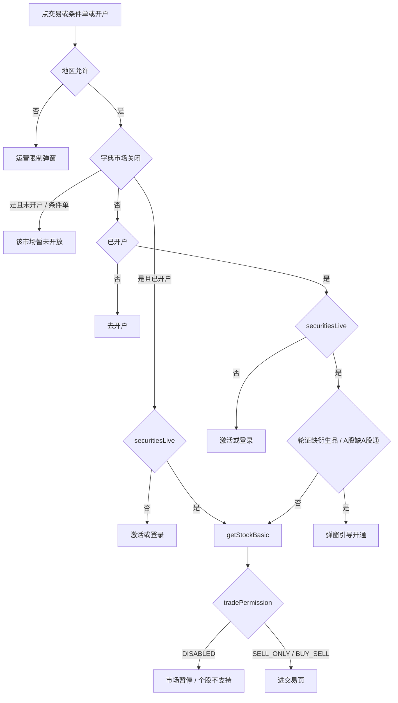

# 市场开放前置门闸改造（在原「交易入口门闸优先级改造」基础上）

## 一、情况清单（请先过目）

说明：「市场关闭」指字典 `MARKET_TRADE_DISABLED` 命中。按你的选择，「暂停交易」和「无牌照未开放」共用这一个字典，前端无法区分。

标记含义：

- 【新】：行为有变化
- 【保持】：和现在一样
- 【待确认】：我给了默认处理，请你拍板
- 【不存在】：实际不会出现，或这次不处理

### 市场关闭

- **C1 未开户**，点交易或开户按钮：弹「该市场暂未开放」，不引导开户。【新】
- **C2 已开户、未激活或未登录 2GO**：仍然引导登录。登录后按 `getStockBasic` 的结果走：有持仓给 `SELL_ONLY` 进仅卖，否则 `DISABLED` 弹市场提示。【待确认】理由是暂停的市场里，老用户可能还有持仓要卖；登录前前端拿不到持仓。
- **C3 已登录，轮证缺衍生品 / A 股缺 A股通**：不弹开通，直接走 `getStockBasic`。【新】
- **C4 已登录，`SELL_ONLY`（有持仓）**：进仅卖。【保持】
- **C5 已登录，`DISABLED`**：弹「该市场已暂停交易」。【保持】
- **C6 条件单**：直接弹市场提示，不进条件单。【新 / 待确认】原规则是条件单不受市场暂停拦截。
- **C7 加密详情，未开虚拟资产账户**：弹市场提示，不引导开虚拟账户。【新】
- **C8 交易页内换标的 / 订单「再次交易」 / 选股 Sheet**：这些入口已经登录，规则和 C3–C5 相同。【新】品种门闸在市场关闭时跳过。

### 市场开放（和原计划一致）

- **O1 地区限制**：弹运营限制弹窗。【保持】
- **O2 未开户**：去开户。【保持】
- **O3 未激活**：去激活或登录。【保持】
- **O4 轮证缺衍生品**：弹窗「取消 / 立即开通」。【保持】
- **O5 A 股缺 A股通**：弹窗「取消 / 立即开通」。【保持】
- **O6 品种已开通，但 `DISABLED`（身份限制 `IDENTITY_MARKET_TRADE_DISABLED`）**：弹「当前股票暂不支持交易」。【保持】
- **O7 `SELL_ONLY` / `BUY_SELL`**：进交易页。【保持】

### 不存在或这次不处理

- **N1 无牌照市场里有持仓**：不会出现，因为这个市场从来没开放过。但字典复用以后，暂停市场里有持仓是真实存在的，所以保留 C2 / C4 的卖出路径。【不存在】
- **N2 美股 / 港股需要申请市场权限**：按你的选择，只有 A 股需要。swagger 里有 `usStock`，这次不接。【不存在】
- **N3 非港股市场的轮证**：衍生品只跟港股走。【不存在】
- **N4 A 股关闭，但用户已经开通 A股通**：比如先开通、后来关闭市场。交易入口按 C3 / C5 处理；交易品种页隐藏 A股通选项，不展示「已开通」。【待确认】
- **N5 A 股只关一个市场（`MA` 关、`MZ` 开，或反过来）**：个股按自己所属的市场判断。A股通选项只有沪深两个都关时才隐藏。【待确认】字典允许这样配置，业务上是否会出现需要你确认。
- **N6 冷启动时字典还没拿到**：按开放处理，登录后由 `getStockBasic` 兜底。【保持】
- **N7 地区限制且市场关闭**：先弹地区限制。【保持】
- **N8 指数 / 板块详情**：没有交易底栏，不涉及。
- **N9 新股认购入口**：港股、美股新股在市场关闭时是否也要拦，这次不改。【待确认】

### 文案【待确认】

- 前置拦截（C1 / C6 / C7）新增 `stock.bottomBar.marketNotOpen`，简体为「该市场暂未开放交易」。
- 登录后 `DISABLED`（C5）仍用现有的「该市场已暂停交易」。
- 如果你希望全部统一成一句，告诉我用哪句。

## 二、新门闸顺序

核心变化有三点：

- 市场判断从第 5 档提到第 2 档。
- 市场关闭时永远跳过品种门闸。
- 未开户的用户在市场关闭时拿不到「去开户」。

## 三、改动

### 1. 字典工具

文件：[src/utils/sysConfigurations.ts](d:/workspace/work7/ok-FinArk-Expo/China-DiFi-Mobile/src/utils/sysConfigurations.ts)

- 新增 `isChinaAMarketFullyClosed()`：沪深都命中（`MA` 和 `MZ`，或者直接配了 `CN` / `A`）才返回 true。
- 新增对应的 `useChinaAMarketFullyClosed()`，基于现有的 `subscribeSysConfigurations`。
- 现有的 `isAnyMarketTradeDisabled` 不改，个股判断继续用它。

### 2. 门闸工具（集中收口）

文件：[src/utils/tradeProductActivation.ts](d:/workspace/work7/ok-FinArk-Expo/China-DiFi-Mobile/src/utils/tradeProductActivation.ts)

- `TradeProductActivationArgs` 新增 `marketTradeDisabled?: boolean | null`，取 Basic 返回值。
- `resolveTradeProductActivationNeed` 增加前置判断：`isAnyMarketTradeDisabled(market, groupCode)` 命中，或者 `marketTradeDisabled === true`，就返回 `null`，也就是跳过品种门闸。这样详情页、交易页、选股 Sheet 三个调用方会自动生效。
- 新增 `isTradeMarketClosed(args)` 和 `showMarketNotOpenDialog()`，供底栏和条件单使用。

### 3. 详情底栏（开户入口）

文件：[StockBottomBar.tsx](d:/workspace/work7/ok-FinArk-Expo/China-DiFi-Mobile/src/components/pages/stock/stock/StockBottomBar.tsx)

- 新增 prop `marketClosed?: boolean`。
- `handlePrimaryPress` 的处理顺序：
  - 先判 `allowedTrade`。
  - 如果 `marketClosed`，并且 `primaryAction === 'openAccount'` 或 `resolveLiveSecuritiesAccountGate() === 'needOpen'`，就调 `showMarketNotOpenDialog()` 并返回。这对应 C1 / C7。
  - 其余情况照旧。
- 「开户」按钮的文案和展示不变，只拦截点击。

### 4. 详情页

文件：[StockDetailScreen.tsx](d:/workspace/work7/ok-FinArk-Expo/China-DiFi-Mobile/src/components/pages/stock/stock/StockDetailScreen.tsx)

- 现有的 `marketTradeDisabledHint` 作为 `marketClosed` 传给底栏。
- `navigateToTrade`：品种门闸调用不用改，工具层已经自动跳过。
- `handleConditionOrder`：在激活判断之前，如果 `marketTradeDisabledHint` 为 true，就弹 `showMarketNotOpenDialog()` 并返回。这对应 C6。
- 跨品类：普通股票、ETF、轮证共用这个页面，会同时生效。

文件：[CryptoDetailScreen.tsx](d:/workspace/work7/ok-FinArk-Expo/China-DiFi-Mobile/src/components/pages/trading/market-tab/crypto/CryptoDetailScreen.tsx)

- 把现有的 `marketTradeDisabledHint` 作为 `marketClosed` 传给底栏。这对应 C7，只拦虚拟账户开户入口。

### 5. 交易页与选股 Sheet

- [Trade.tsx](d:/workspace/work7/ok-FinArk-Expo/China-DiFi-Mobile/src/components/pages/trade/Trade.tsx) 的 `getStockBasic.then`：调 `interceptTradeProductActivation` 时补传 `marketTradeDisabled: d.marketTradeDisabled`。
- [SelectStock/index.tsx](d:/workspace/work7/ok-FinArk-Expo/China-DiFi-Mobile/src/components/common/SelectStock/index.tsx) 的 `ensureAllowTradeBeforeTradeNav`：同样补传。
- 上面两处补传后，市场关闭时直接落到原有的 `DISABLED` / `SELL_ONLY` 分支。

### 6. App 交易品种页：隐藏 A股通

文件：[TradeProductActivationScreen.tsx](d:/workspace/work7/ok-FinArk-Expo/China-DiFi-Mobile/src/components/pages/account/trade-products/TradeProductActivationScreen.tsx)

- 用 `useChinaAMarketFullyClosed()` 得到 `chinaConnectAvailable`。
- 不可用时不渲染 A股通这一行，同时调整相关逻辑：
  - 路由带 `preselect=chinaConnect` 时忽略，回落到衍生品。
  - 自动选中逻辑跳过 A股通。
  - `bothActivated` 改成「所有可见项都已开通」。
- 进页时调一次 `ensureSysConfigurations()`，兜底冷启动时缓存还没就绪的情况。
- 在这一行旁边写备注：「A股市场关闭时暂为隐藏；后续若改为置灰显示『暂未开放』，在此改为渲染 disabled 行，并保持 canSubmit 拦截」。

### 7. H5 交易品种页：隐藏 A股通

- [stores/common.ts](d:/workspace/work7/ok-FinArk-Expo/China-DiFi-h5/packages/www/src/stores/common.ts)：`commonState` 新增 `marketTradeDisabled: string[]`。`applySysConfigurations` 里解析这个字段，兼容数组和逗号分隔字符串，统一转大写。
- [trade-products/shared.ts](d:/workspace/work7/ok-FinArk-Expo/China-DiFi-h5/packages/www/src/pages/mobile/trade-products/shared.ts)：
  - 新增 `isChinaAMarketFullyClosed()`，口径和 App 一致。
  - `resolveInitialSelected` 增加 `chinaConnectAvailable` 参数。
- [trade-products/index.tsx](d:/workspace/work7/ok-FinArk-Expo/China-DiFi-h5/packages/www/src/pages/mobile/trade-products/index.tsx)：
  - `onMount` 里，如果 `sysConfigReady` 还没就绪，先 `await loadSysConfigurations()`，再 `syncGranted`。页面在 loading 期间不渲染选项，避免 A股通闪一下又消失。
  - 用 `<If>` 隐藏 A股通行，`bothActivated` 改成按可见项判断。
  - 备注写法同 App。
- H5「加开账户」（`SelectTypes.tsx`）早已过滤 A股通，不改。

### 8. 文案（三语）

- App 的 `src/i18n/locales/{zh-CN,zh-TW,en-US}.ts`，在 `stock.bottomBar` 下新增 `marketNotOpen`：
  - 简体：「该市场暂未开放交易」
  - 繁体：「該市場暫未開放交易」
  - 英文：「Trading in this market is not available yet」

### 9. 规则

文件：[.cursor/rules/trade-entry-gate.mdc](d:/workspace/work7/ok-FinArk-Expo/China-DiFi-Mobile/.cursor/rules/trade-entry-gate.mdc)

- 重写顺序表：市场字典提到第 2 档，并写明三种情况：
  - 未开户：拦截。
  - 已开户：继续走后续门闸，但跳过品种门闸。
  - 条件单：拦截。
- 删除旧的强约定「品种先于市场暂停」，改成「市场关闭时不引导开户、不引导品种开通」。
- 补充 A股通选项的显隐口径（沪深都关才隐藏），以及「将来可能改成置灰」的备注。

## 四、验收用例

- 字典配置 `HK`：
  - 未开户的用户点港股「开户」或「交易」，弹「该市场暂未开放交易」，不跳开户。
  - 已登录且有持仓：进仅卖。
  - 已登录且无持仓：弹「该市场已暂停交易」。
- 字典配置 `HK`，已登录、未开通衍生品的用户点轮证：不弹「开通衍生品」，按 Basic 的结果处理。
- 字典配置 `MA,MZ`：
  - App 和 H5 的交易品种页都看不到 A股通。
  - 已开通衍生品的用户看到「全部已开通」。
  - 未开通 A股通的用户点 A 股：不弹开通弹窗。
- 字典只配 `MA`：A股通选项照常显示；沪市个股走市场关闭的逻辑，深市个股走正常逻辑。
- 字典为空：行为和原计划完全一致（O1–O7）。
- 条件单：港股字典关闭时点条件单，弹市场提示。

改动只在点击或进页时读一次内存里的字典，没有新增订阅、定时器或轮询。App 交易品种页用 `useSyncExternalStore` 订阅字典，只在配置真正变化时重渲染。
