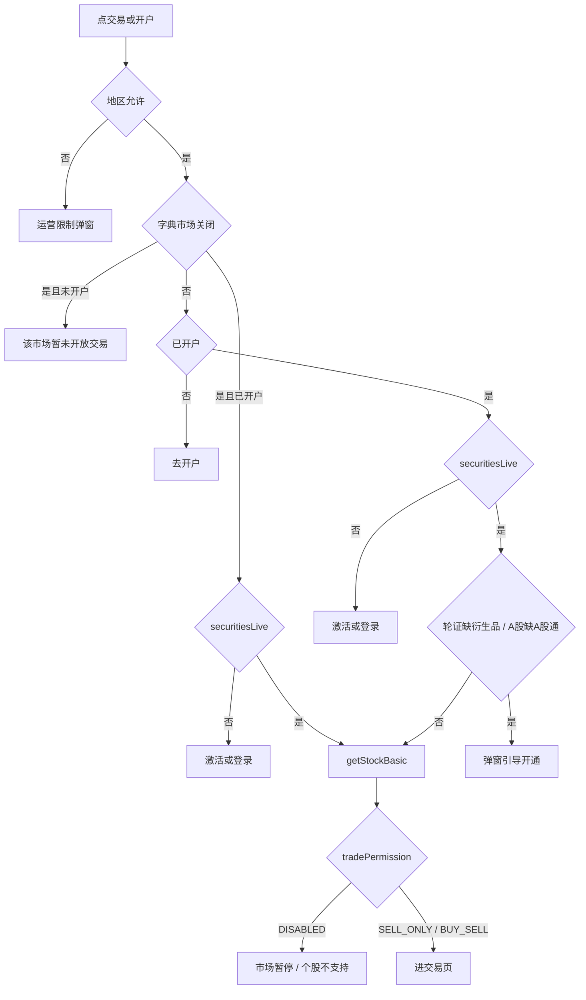

# 市场开放前置门闸改造（在原「交易入口门闸优先级改造」基础上）

## 一、情况清单（请先过目）

说明：「市场关闭」指字典 `MARKET_TRADE_DISABLED` 命中。按你的选择，「暂停交易」和「无牌照未开放」共用这一个字典，前端无法区分。

标记含义：

- 【新】：行为有变化
- 【保持】：和现在一样
- 【待确认】：我给了默认处理，请你拍板
- 【不存在】：实际不会出现，或这次不处理

### 市场关闭

- **C1 未开户**，点交易或开户按钮：弹「该市场暂未开放」，不引导开户。【新】
- **C2 已开户、未激活或未登录 2GO**：仍然先引导登录，不弹市场关闭。【保持】登录前不请求 `getStockBasic`，前端也没有持仓可以拿来判断。详情页没有登录成功回调，不会自动续进交易。用户再点一次时会话已是 `securitiesLive`，当场再打一次 `getStockBasic`，按当次 `tradePermission` 走 C4 / C5。「暂停市场里老用户可能还有仓」只在服务端；这次不新增「登录前记下持仓、登录后沿用」的逻辑。
- **C3 已登录，轮证缺衍生品 / A 股缺 A股通**：不弹开通，直接走 `getStockBasic`。【新】
- **C4 已登录，`SELL_ONLY`（有持仓）**：进仅卖。【保持】
- **C5 已登录，`DISABLED`**：弹「该市场已暂停交易」。【保持】
- **C6 条件单**：目前只有港股有条件单，正式环境港股不会设市场关闭。条件单暂时不受市场关闭拦截，保持现状（仍走激活、品种门闸；市场关闭时品种门闸由工具层自动跳过）。【保持】
- **C7 加密详情，未开虚拟资产账户**：弹市场提示，不引导开虚拟账户。【新】
- **C8 交易页内换标的 / 订单「再次交易」 / 选股 Sheet**：这些入口已经登录，规则和 C3–C5 相同。【新】品种门闸在市场关闭时跳过。

### 市场开放（和原计划一致）

- **O1 地区限制**：弹运营限制弹窗。【保持】
- **O2 未开户**：去开户。【保持】
- **O3 未激活**：去激活或登录。【保持】
- **O4 轮证缺衍生品**：弹窗「取消 / 立即开通」。【保持】
- **O5 A 股缺 A股通**：弹窗「取消 / 立即开通」。【保持】
- **O6 品种已开通，但 `DISABLED`（身份限制 `IDENTITY_MARKET_TRADE_DISABLED`）**：弹「当前股票暂不支持交易」。【保持】
- **O7 `SELL_ONLY` / `BUY_SELL`**：进交易页。【保持】

### 不存在或这次不处理

- **N1 无牌照市场里有持仓**：不会出现，因为这个市场从来没开放过。字典复用以后，暂停市场里有持仓是服务端事实；前端不在未登录时判断，登 2GO 后再点才走 C4 / C5。【不存在】
- **N2 美股 / 港股需要申请市场权限**：按你的选择，只有 A 股需要。swagger 里有 `usStock`，这次不接。【不存在】
- **N3 非港股市场的轮证**：衍生品只跟港股走。【不存在】
- **N4 A 股关闭，但用户已经开通 A股通**：比如先开通、后来关闭市场。交易入口按 C3 / C5 处理；交易品种页隐藏 A股通选项，不展示「已开通」。【已确认】
- **N5 A 股只关一个市场（`MA` 关、`MZ` 开，或反过来）**：个股仍按自己所属的市场判断（沪市关则沪市股走市场关闭，深市股照常，未开 A股通仍弹开通）；A股通选项要 `MA` 和 `MZ` 都命中才隐藏。【已确认】
- **N6 冷启动时字典还没拿到**：按开放处理，登录后由 `getStockBasic` 兜底。【保持】
- **N7 地区限制且市场关闭**：先弹地区限制。【保持】
- **N8 指数 / 板块详情**：没有交易底栏，不涉及。
- **N9 新股认购入口**：暂时不做市场关闭拦截，保持旧逻辑。【已确认】

### 文案【已确认】

- 前置拦截（C1 / C7）新增 `stock.bottomBar.marketNotOpen`：「该市场暂未开放交易」。
- 登录后 `DISABLED`（C5）沿用现有 `stock.bottomBar.marketTradeDisabled`：「该市场已暂停交易」。

## 二、新门闸顺序

核心变化有三点：

- 市场判断从第 5 档提到第 2 档。
- 市场关闭时永远跳过品种门闸。
- 未开户的用户在市场关闭时拿不到「去开户」。

图里「激活或登录」没有连回 `getStockBasic`：登录成功不会自动续进交易。用户再点一次，此时已是 `securitiesLive`，才打 Basic。市场关闭不改变这条顺序（C2）。

## 三、改动

### 1. 字典工具

文件：[src/utils/sysConfigurations.ts](d:/workspace/work7/ok-FinArk-Expo/China-DiFi-Mobile/src/utils/sysConfigurations.ts)

- 新增 `isChinaAMarketFullyClosed()`：沪深都命中才返回 true，即 (`MA` 或 `SH`/`SS`) 且 (`MZ` 或 `SZ`)，或者直接配了 `CN` / `A`。
- 新增对应的 `useChinaAMarketFullyClosed()`，基于现有的 `subscribeSysConfigurations`。
- 新增 `isStockMarketTradeClosed({ market, groupCode })`，个股门闸统一用它：
  - 有具体市场码（`MA` / `MZ` / `SH` / `SZ` / `HK` / `US` 等）时只按具体市场判断。
  - 只有 groupCode `CN` 时，按 `isChinaAMarketFullyClosed()` 判断，避免「只关沪市」把深市股也当成关闭。现有 `isMarketTradeDisabled('CN')` 是任一命中即 true，不能直接用在门闸上。
  - 详情页现有的 `marketTradeDisabledHint`（`isAnyMarketTradeDisabled(market, groupCode, ...)`）同样改用这个函数。
- 现有的 `isAnyMarketTradeDisabled` 不改，个股判断继续用它。

### 2. 门闸工具（集中收口）

文件：[src/utils/tradeProductActivation.ts](d:/workspace/work7/ok-FinArk-Expo/China-DiFi-Mobile/src/utils/tradeProductActivation.ts)

- `TradeProductActivationArgs` 新增 `marketTradeDisabled?: boolean | null`，取 Basic 返回值。
- `resolveTradeProductActivationNeed` 增加前置判断：`isStockMarketTradeClosed({ market, groupCode })` 命中，或者 `marketTradeDisabled === true`，就返回 `null`，也就是跳过品种门闸。这样详情页、交易页、选股 Sheet 三个调用方会自动生效。
- 调用方要尽量传具体市场码（详情页传 `stockIdentity.market`，交易页 / 选股传 `d.market`），不要只传 `CN`。
- 「开通页没有 A股通选项」只会发生在沪深都关时；这时所有 A 股个股都已命中市场关闭、跳过品种门闸，不会被引到死路，不需要额外处理。
- 新增 `showMarketNotOpenDialog()`，供底栏使用。

### 3. 详情底栏（开户入口）

文件：[StockBottomBar.tsx](d:/workspace/work7/ok-FinArk-Expo/China-DiFi-Mobile/src/components/pages/stock/stock/StockBottomBar.tsx)

- 新增 prop `marketClosed?: boolean`。
- `handlePrimaryPress` 的处理顺序：
  - 先判 `allowedTrade`。
  - 如果 `marketClosed`，并且 `primaryAction === 'openAccount'` 或 `resolveLiveSecuritiesAccountGate() === 'needOpen'`，就调 `showMarketNotOpenDialog()` 并返回。这对应 C1 / C7。
  - `goLogin` / `needActivate`（C2）不走这层拦截，仍进登录。这里不要读持仓或 `tradePermission`。
- 「开户」按钮的文案和展示不变，只拦截点击。

### 4. 详情页

文件：[StockDetailScreen.tsx](d:/workspace/work7/ok-FinArk-Expo/China-DiFi-Mobile/src/components/pages/stock/stock/StockDetailScreen.tsx)

- 现有的 `marketTradeDisabledHint` 作为 `marketClosed` 传给底栏。
- `handleTrade` 仍先 `interceptIfNeedActivate`。不要给 `useActivateGoAccount` 加 `onActivated` 去自动 `navigateToTrade`。
- `navigateToTrade` 继续只用当次 `refresh()` 的返回值。请求失败就返回，不要改用 hook 里保留的上次 `tradePermission` / `hasPosition`（详情页现在也没读这两个 state）。
- `navigateToTrade`：品种门闸调用不用改，工具层已经自动跳过。这次跳过只发生在已经 `securitiesLive`、再次点击之后。
- `handleConditionOrder`：不加市场拦截（C6）。它调用的品种门闸在市场关闭时由工具层自动跳过，无需改代码。
- 跨品类：普通股票、ETF、轮证共用这个页面，会同时生效。

文件：[CryptoDetailScreen.tsx](d:/workspace/work7/ok-FinArk-Expo/China-DiFi-Mobile/src/components/pages/trading/market-tab/crypto/CryptoDetailScreen.tsx)

- 把现有的 `marketTradeDisabledHint` 作为 `marketClosed` 传给底栏。这对应 C7，只拦虚拟账户开户入口。
- 加密的 `handleTrade` 同样是 `needActivate` 先登录并返回，没有登录成功续进。不要在这里补 `onActivated`。hook 里上次成功的 `tradePermission` 只可能来自已经登上 2GO 的那次请求，市场关闭改动不要改成登录前读取它。

### 5. 交易页与选股 Sheet

- [Trade.tsx](d:/workspace/work7/ok-FinArk-Expo/China-DiFi-Mobile/src/components/pages/trade/Trade.tsx) 的 `getStockBasic.then`：调 `interceptTradeProductActivation` 时补传 `marketTradeDisabled: d.marketTradeDisabled`。
- [SelectStock/index.tsx](d:/workspace/work7/ok-FinArk-Expo/China-DiFi-Mobile/src/components/common/SelectStock/index.tsx) 的 `ensureAllowTradeBeforeTradeNav`：同样补传。
- 上面两处补传后，市场关闭时直接落到原有的 `DISABLED` / `SELL_ONLY` 分支。

### 6. App 交易品种页：隐藏 A股通

文件：[TradeProductActivationScreen.tsx](d:/workspace/work7/ok-FinArk-Expo/China-DiFi-Mobile/src/components/pages/account/trade-products/TradeProductActivationScreen.tsx)

- 用 `useChinaAMarketFullyClosed()` 得到 `chinaConnectAvailable = !fullyClosed`。
- 不可用时不渲染 A股通这一行，同时调整相关逻辑：
  - 路由带 `preselect=chinaConnect` 时忽略，回落到衍生品。
  - 自动选中逻辑跳过 A股通。
  - `bothActivated` 改成「所有可见项都已开通」。
- 进页时调一次 `ensureSysConfigurations()`，兜底冷启动时缓存还没就绪的情况。
- 在这一行旁边写备注：「A股市场关闭时暂为隐藏；后续若改为置灰显示『暂未开放』，在此改为渲染 disabled 行，并保持 canSubmit 拦截」。

### 7. H5 交易品种页：隐藏 A股通

- [stores/common.ts](d:/workspace/work7/ok-FinArk-Expo/China-DiFi-h5/packages/www/src/stores/common.ts)：`commonState` 新增 `marketTradeDisabled: string[]`。`applySysConfigurations` 里解析这个字段，兼容数组和逗号分隔字符串，统一转大写。
- [trade-products/shared.ts](d:/workspace/work7/ok-FinArk-Expo/China-DiFi-h5/packages/www/src/pages/mobile/trade-products/shared.ts)：
  - 新增 `isChinaAMarketFullyClosed()`，口径和 App 一致：沪（`MA`/`SH`/`SS`）和深（`MZ`/`SZ`）都命中，或配了 `CN` / `A`，才算关闭。
  - `resolveInitialSelected` 增加 `chinaConnectAvailable` 参数。
- [trade-products/index.tsx](d:/workspace/work7/ok-FinArk-Expo/China-DiFi-h5/packages/www/src/pages/mobile/trade-products/index.tsx)：
  - `onMount` 里，如果 `sysConfigReady` 还没就绪，先 `await loadSysConfigurations()`，再 `syncGranted`。页面在 loading 期间不渲染选项，避免 A股通闪一下又消失。
  - 用 `<If>` 隐藏 A股通行，`bothActivated` 改成按可见项判断。
  - 备注写法同 App。
- H5「加开账户」（`SelectTypes.tsx`）早已过滤 A股通，不改。

### 8. 文案（三语）

- App 的 `src/i18n/locales/{zh-CN,zh-TW,en-US}.ts`，在 `stock.bottomBar` 下新增 `marketNotOpen`：
  - 简体：「该市场暂未开放交易」
  - 繁体：「該市場暫未開放交易」
  - 英文：「Trading in this market is not available yet」

### 9. 规则

文件：[.cursor/rules/trade-entry-gate.mdc](d:/workspace/work7/ok-FinArk-Expo/China-DiFi-Mobile/.cursor/rules/trade-entry-gate.mdc)

- 重写顺序表：市场字典提到第 2 档，并写明三种情况：
  - 未开户：拦截。
  - 已开户但未 `securitiesLive`：先登录，不弹市场关闭。登录不自动续进；再次点击才打 `getStockBasic`，按当次 `tradePermission` 走仅卖或市场暂停。禁止登录前缓存持仓。
  - 已开户且已 `securitiesLive`：跳过品种门闸，直接 `getStockBasic`。
  - 条件单（目前仅港股）：暂不受市场关闭拦截。
- 删除旧的强约定「品种先于市场暂停」，改成「市场关闭时不引导开户、不引导品种开通」。
- 补充 A股通选项的显隐口径（`MA` 和 `MZ` 都关闭才隐藏），以及「将来可能改成置灰」的备注。
- 写明个股门闸必须按具体市场码判断，禁止用 `CN` 的「任一命中」口径。
- 注明新股认购入口不做市场关闭拦截。

## 四、验收用例

- 字典配置 `HK`：
  - 未开户的用户点港股「开户」或「交易」，弹「该市场暂未开放交易」，不跳开户。
  - 已开户但未登 2GO：点交易进登录，不弹市场关闭，也不打 `getStockBasic`。登录后回到详情再点：有持仓进仅卖，无持仓弹「该市场已暂停交易」。
  - 已登录且有持仓：进仅卖。
  - 已登录且无持仓：弹「该市场已暂停交易」。
- 字典配置 `HK`，已登录、未开通衍生品的用户点轮证：不弹「开通衍生品」，按 Basic 的结果处理。
- 字典配置 `MA,MZ`：
  - App 和 H5 的交易品种页都看不到 A股通。
  - 已开通衍生品的用户看到「全部已开通」。
  - 未开通 A股通的用户点 A 股：不弹开通弹窗。
- 字典只配 `MA`：
  - App 和 H5 交易品种页仍显示 A股通。
  - 沪市个股走市场关闭的逻辑（未开户弹「该市场暂未开放交易」，不弹 A股通开通）。
  - 深市个股完全走正常逻辑：未开户去开户，未开 A股通弹开通弹窗。
- 字典为空：行为和原计划完全一致（O1–O7）。
- 条件单：行为不变，不弹市场提示。
- 新股认购：行为不变。

改动只在点击或进页时读一次内存里的字典，没有新增订阅、定时器或轮询。App 交易品种页用 `useSyncExternalStore` 订阅字典，只在配置真正变化时重渲染。
